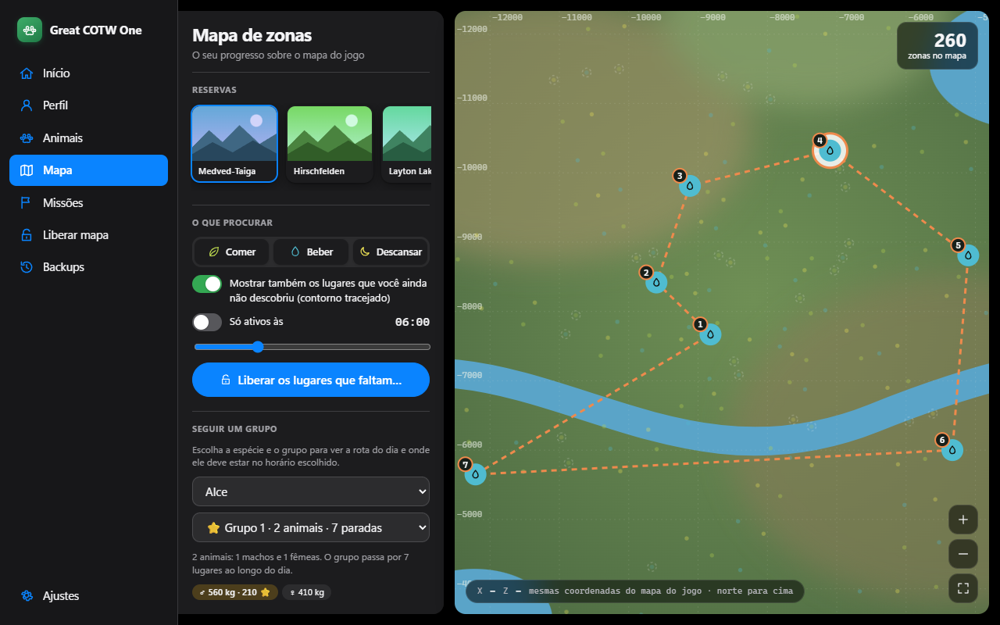
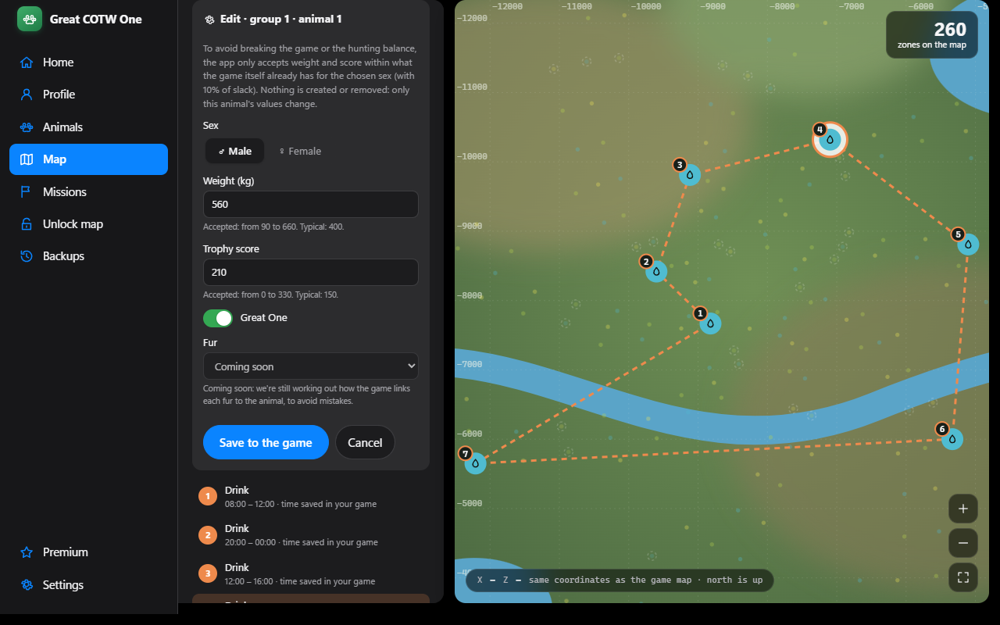
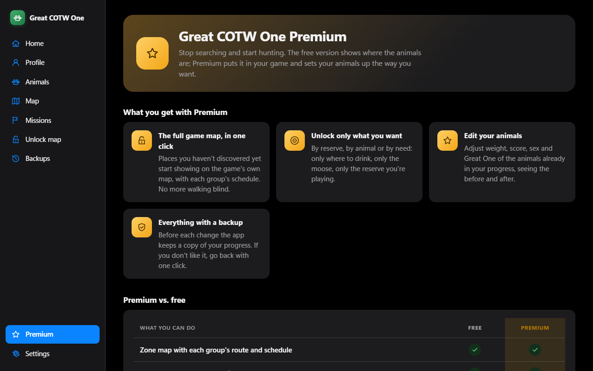

<div align="center">

# 🦌 Great COTW One

**Your hunting companion for _theHunter: Call of the Wild_.**
See where every animal group goes and when, plus your whole progress, in your own language and with nothing technical to learn.

[**⬇️ Download for Windows**](https://otavioprocopio.github.io/great-cotw-one-site/) · [How to install](#-how-to-install) · [For developers](#-for-developers) · [Português](README.md)



</div>

---

## ✨ What it does

The app reads **your** save and **your** installed game and turns everything into simple screens. No spreadsheets, no code: open it and use it. It speaks **English, Español and Português (Brasil)**, and animal names, missions and achievements follow your language.

### 🗺️ Zone map and group tracker
See where animals eat, drink and rest, on the game's own map. Pick a group and the app draws its **daily route** with the time of each stop and shows where it should be right now. Filter by species, zone type and time of day. Zones you haven't discovered yet are shown too, with a dashed outline.

### ✏️ Edit your animals · _Premium_
While tracking a group you see its animals. With Premium, each one has an **edit button**: change **sex** (male ⇄ female), **weight**, **trophy score** and the **Great One** mark. To keep the game safe and balanced, the app only accepts values within what the game itself already has for that species and sex, suggests typical values when you swap sex, never creates or removes animals, and keeps a backup before saving.



### 🔓 Unlock the map · _Premium_
The game only shows a zone after you discover it. **For free**, the app already shows what's missing and how many places each reserve, animal and need would gain. **With Premium**, it writes those zones into your game, **with schedules**, and you choose **by reserve**, **by animal** or **by need** (only where to drink, for instance). Before changing anything it shows what will happen, asks you to confirm and keeps a copy of your progress.

### 🐾 Animal wiki, 👤 profile and 🎯 missions
Every reserve of the game with its species, and for each one where it lives, how many you have, your best harvests. Your level, shots, accuracy and **Steam achievements** with search and filters. Your progress in every reserve with the game's own mission texts.

### 🛡️ Backups
Every change keeps a full copy first. If something isn't how you wanted, go back to the earlier moment with one click.

> The screenshots use sample data and drawings. In the real app you see the map and covers from your own game.

---

## 💎 Premium

| | Free | Premium |
|---|:---:|:---:|
| Map with each group's route and schedule | ✅ | ✅ |
| See the zones you haven't discovered yet | ✅ | ✅ |
| Animal wiki, profile, achievements, missions | ✅ | ✅ |
| Backups and going back at any time | ✅ | ✅ |
| Unlock zones in the game (by reserve, animal or need) | — | ✅ |
| Edit weight, score, sex and Great One of your animals | — | ✅ |

**R$ 15 per month or R$ 75 per year** (the yearly plan is 58% cheaper). The license is a key you paste into the app; it is checked offline and sends none of your data. When it expires, the app goes back to free mode without deleting anything.



---

## 📥 How to install

1. Open the [**website**](https://otavioprocopio.github.io/great-cotw-one-site/) page and download `Great COTW One_x.y.z_x64-setup.exe`.
2. Double-click it. It installs for your user only and **asks for no administrator password**.
3. Open **Great COTW One**. It finds your save and game by itself; if it can't, **Settings** has a button to point to the folder.

**Windows says "Windows protected your PC"?** The installer doesn't have a paid digital signature yet, so SmartScreen distrusts any new program. Click **More info → Run anyway**.

**Requirements:** Windows 10 or 11, the game installed through Steam and at least one saved game.

---

## 🔒 Safe by design

- **Automatic backup** before any write. Backups are never deleted.
- **Never writes while the game is open**: the app checks first.
- **Shows first, checks after**: every change is displayed for you to confirm and read back to verify.
- **Single-player only.** No multiplayer, no game automation.
- **No game files in the installer or in this repository**: the app reads your installation on the fly.

## 🧭 Project status

**Ready:** map and tracker, unlock zones, edit animals (Premium), animal wiki, profile and achievements, missions per reserve, backups, Premium license (offline activation), three languages and the Windows installer.

**Missing for 1.0:**
- **Store** to sell Premium (for now the button only says it hasn't opened) and the first published release.
- **In-game tests** by players: seeing the unlocked zones and edited animals in the game itself.
- **Fur:** choosing an animal's fur and the fur guide with real chances (the seed-to-fur formula is still unknown).
- **Diamond shortcuts** ("1 diamond per group") and Great One per species, which need the game's diamond ranges.
- **Career:** mission chains with their givers, "what's missing" per achievement and a build planner.
- **Maps** of Askiy Ridge and Intisuyu to confirm with DLC owners; translations to review with native speakers; more languages (French, German, Russian, Polish).

Task-level detail lives in `openspec/changes/`.

---

## 🛠️ For developers

Fan project, not affiliated with Expansive Worlds or Avalanche Studios. Built with **Tauri 2 (Rust) + TypeScript** and driven with [OpenSpec](https://github.com/Fission-AI/OpenSpec) (specs first, then code). See [docs/DEVELOPMENT.md](docs/DEVELOPMENT.md) (in Portuguese) for how to run, test, add a language and issue license keys.

```
crates/cotw-formats   readers for the save and game formats (ADF, AAF, SARC, textures…)
crates/cotw-core      rules: discovery, backups, safe writing, map, missions, animals, license
crates/license-tool   the seller's tool: generate keys and issue licenses
src-tauri             the app (Tauri)
ui                    the interface (TypeScript + Vite)
openspec              current specs and changes in progress
```

```powershell
cd ui; npm install                              # once
cargo test --workspace; cd ui; npm test         # tests
cargo lint; cargo fmt-check                     # quality
cd ui; npm run tauri build                      # builds the installer
```

## 📄 License

**Proprietary, private** source code. All rights reserved (see `LICENSE`). The app is distributed only as an installer, through the website: https://otavioprocopio.github.io/great-cotw-one-site/
