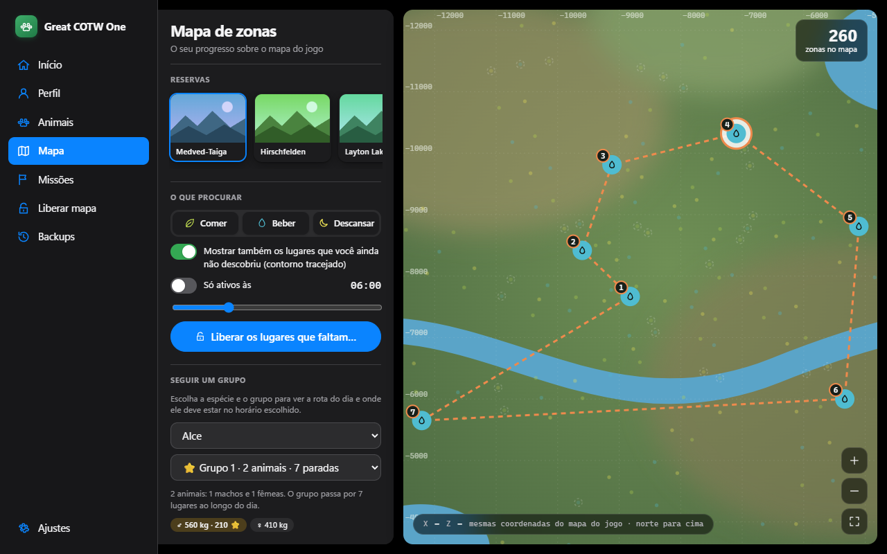
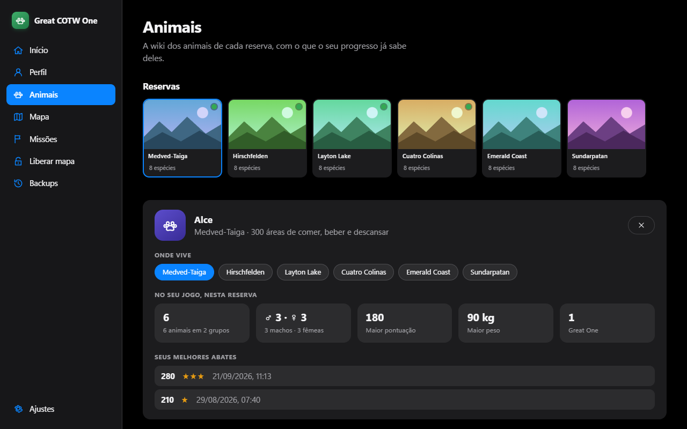
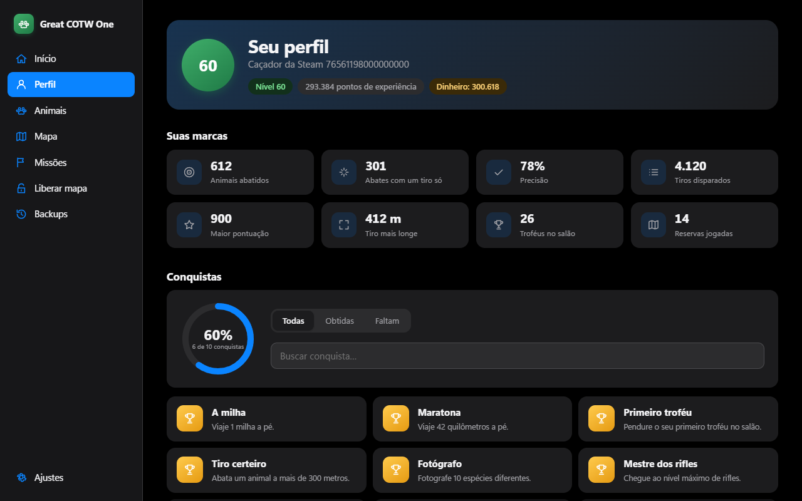
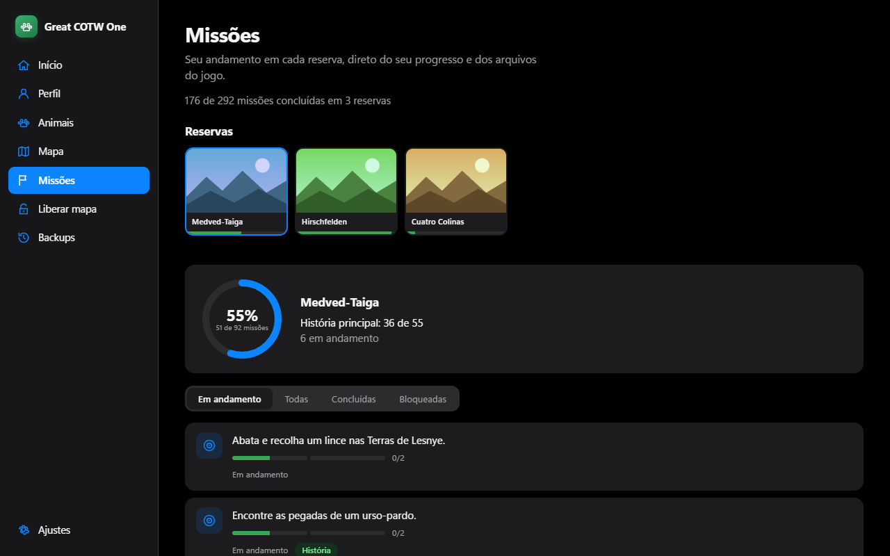

<div align="center">

# 🦌 Great COTW One

**Seu parceiro de caça para o _theHunter: Call of the Wild_.**
Veja onde cada grupo de animais passa, a que horas, e o seu progresso inteiro, tudo em português e sem mexer em nada técnico.

[**⬇️ Baixar para Windows**](https://github.com/OtavioProcopio/great-cotw-one/releases/latest) · [Como instalar](#-como-instalar) · [Para quem desenvolve](#-para-quem-desenvolve)



</div>

---

## ✨ O que ele faz

O app lê o **seu** save e o **seu** jogo instalado e transforma tudo em telas simples. Nada de planilha, nada de código: é só abrir e usar.

### 🗺️ Mapa de zonas e rastreador de grupos
Veja onde os animais comem, bebem e descansam, no mapa do próprio jogo. Escolha um grupo e o app desenha a **rota do dia** com o horário de cada parada e mostra onde ele deve estar agora. Filtre por espécie, por tipo de zona e por horário.

### 🔓 Liberar o mapa
O jogo só mostra uma zona depois que você a descobre. O app calcula as que os seus grupos realmente usam e grava no save, **com horários**. Antes de mudar qualquer coisa ele mostra o que vai acontecer, pede a sua confirmação e guarda uma cópia do seu progresso.

### 🐾 Wiki dos animais
Todas as reservas do jogo, com as espécies de cada uma. Em cada ficha: onde o animal vive, quantos você tem no save (machos, fêmeas, Great Ones, maior peso e pontuação) e os seus melhores abates.



### 👤 Perfil e conquistas
Nível, abates, precisão de tiro, tiro mais longe, troféus e as **conquistas da Steam em português**, com filtro e busca.



### 🎯 Missões por reserva
Quanto falta em cada reserva, o que está em andamento e a lista de missões com o texto do próprio jogo.



### 🛡️ Backups
Cada mudança guarda antes uma cópia completa. Se algo não ficou como você queria, volte ao momento anterior com um clique.

> As imagens acima usam dados e desenhos de exemplo. No app de verdade você vê o mapa e as capas do seu jogo.

---

## 📥 Como instalar

1. Abra a página de [**Releases**](https://github.com/OtavioProcopio/great-cotw-one/releases/latest) e baixe o arquivo `Great COTW One_x.y.z_x64-setup.exe`.
2. Dê dois cliques. A instalação é só para o seu usuário e **não pede senha de administrador**.
3. Abra o **Great COTW One**. Ele acha sozinho o seu save e o jogo; se não achar, a tela de **Ajustes** tem um botão para indicar a pasta.

**Windows avisou "o Windows protegeu o computador"?** O instalador ainda não tem assinatura digital paga, então o SmartScreen desconfia de qualquer programa novo. Clique em **Mais informações → Executar assim mesmo**.

**Precisa de:** Windows 10 ou 11, o jogo instalado pela Steam e pelo menos uma partida salva.

---

## 🔒 Seguro por design

- **Backup automático** antes de qualquer gravação. Os backups nunca são apagados.
- **Nunca grava com o jogo aberto**: o app confere antes.
- **Mostra antes, confere depois**: toda mudança é exibida para você confirmar e relida para verificar.
- **Só single-player.** Nada de multiplayer, nada de automação do jogo.
- **Nenhum arquivo do jogo vai para o instalador nem para este repositório**: o app lê a sua instalação na hora.

## 🧭 Em breve

- Guia de pelagens com as chances reais do jogo
- Planejador de build (habilidades e vantagens)
- Cadeias de missões e "o que falta" de cada conquista
- **Premium:** editor de animais (pontuação, peso, sexo, pelagem, Great One)

---

## 🛠️ Para quem desenvolve

Projeto de fã, sem ligação com a Expansive Worlds nem com a Avalanche Studios. Feito com **Tauri 2 (Rust) + TypeScript** e conduzido com [OpenSpec](https://github.com/Fission-AI/OpenSpec) (specs primeiro, depois código).

```
crates/cotw-formats   leitura dos formatos do save e do jogo (ADF, AAF, SARC, texturas…)
crates/cotw-core      regras: descoberta, backups, escrita segura, mapa, missões, animais
src-tauri             o aplicativo (Tauri)
ui                    a interface (TypeScript + Vite)
openspec              specs vigentes e changes em andamento
docs/DEVELOPMENT.md   como rodar, testar e o que cada parte lê do jogo
```

```powershell
cd ui; npm install                              # uma vez
cargo test --workspace; cd ui; npm test         # testes
cargo lint; cargo fmt-check                     # qualidade
cd ui; npm run tauri dev                        # abre o app em modo de desenvolvimento
cd ui; npm run tauri build                      # gera o instalador
```

Os testes com saves e jogo reais usam a pasta `fixtures/` (que **nunca** é versionada) e são ignorados quando ela não existe.

- `openspec/changes/` — o que está sendo construído e o estado de cada tarefa. Validar: `openspec validate --all`.
- `.claude/skills/cotw-save-knowledge/SKILL.md` — formatos do save e do jogo, hashes e o que é seguro editar.
- `research/reference/` — implementações de referência usadas como oráculo dos testes.
